# Primitive Pictures

Russian: [README.ru.md](README.ru.md).

Reproducing images with geometric primitives: `primitive` takes a picture and
writes it back as a set of triangles, ellipses, rectangles or curves, as PNG,
JPEG, SVG or animated GIF.

This repository is a fork of
[fogleman/primitive](https://github.com/fogleman/primitive) by Michael Fogleman
and keeps its MIT license, see [License](#license). The fork has its own Go
module, spends far less CPU per picture, writes GIF without ImageMagick and adds
`-seed`, `-nc` and `-version`. [CHANGELOG.md](CHANGELOG.md) lists every
difference and what it breaks.

This page covers installation, flags, formats, CPU and memory limits, the
algorithm, examples, development and releases. The Go API is documented in the
source, and mutation testing in [docs/mutants.md](docs/mutants.md).

## How it Works

A target image is provided as input. The algorithm tries to find the single most
optimal shape that can be drawn to minimize the error between the target image
and the drawn image. It repeats this process, adding *one shape at a time*.
Around 50 to 200 shapes are needed to reach a result that is recognizable yet
artistic and abstract.

## Installation

Binaries and images exist from the first `vX.Y.Z` tag on. Before that tag, use
`go install` or build from source.

### Release Archives

The [releases page](https://github.com/6RUN0/primitive/releases) has archives
for Linux, macOS, FreeBSD (`.tar.gz`) and Windows (`.zip`), each for amd64 and
arm64, with `checksums.txt`. Every file listed in `checksums.txt` has a build
provenance attestation. To check an archive:

```sh
VERSION=1.2.3
gh attestation verify "primitive_${VERSION}_linux_amd64.tar.gz" --repo 6RUN0/primitive
```

The binary is static and needs no other program. An archive also holds the
license, both READMEs, both changelogs and `docs/`, but not `examples/`, so the
pictures of [Examples](#examples) show only on the repository page.

### Container Image

`ghcr.io/6run0/primitive` is a distroless image for linux/amd64 and linux/arm64
with the binary as its entry point. Tags are the version without `v` and
`latest`, which release candidates do not move. The image has no attestation.

The image runs as user 65532 and cannot write to a directory it does not own:
the search finishes, then the program exits with code 1. Mount a directory and
pass your user:

```sh
docker run --rm -u "$(id -u):$(id -g)" -v "$PWD:/work" ghcr.io/6run0/primitive \
    -i /work/input.png -o /work/output.gif -n 100
```

### Go Install

Requires [Go](https://go.dev/doc/install) 1.27.0 or newer. `go.mod` names the
toolchain `go1.27.3`, because 1.27.0 has known vulnerabilities in the standard
library. With the default `GOTOOLCHAIN=auto`, an older local Go downloads that
toolchain. With `GOTOOLCHAIN=local`, Go below 1.27.0 refuses the build, and
1.27.0 to 1.27.2 build with themselves.

```sh
go install github.com/6RUN0/primitive@latest
primitive -i input.png -o output.png -n 100
```

### Build from Source

```sh
go build -o primitive.bin .
./primitive.bin -i input.png -o output.png -n 100
```

The `-o primitive.bin` argument is required: a plain `go build` fails with
`build output "primitive" already exists and is a directory`, because the
package directory has the name of the binary. `make` runs the same command.

## Usage

```sh
primitive [OPTIONS] -i input -o output -n count
```

`-i`, `-o` and `-n` are required. Files named by `-o` are overwritten without a
question.

The default of `-r` reduces the input to 256 pixels, and that is usually enough:
fine detail does not survive the shapes, and the run is faster.

Several outputs from one search:

```sh
primitive -i input.png -o output.png -o output.svg -n 100
```

The search stages of one picture, here 50 triangles, then 100 ellipses with more
opacity. `-m`, `-a`, `-rep` and `-mqw` apply to the `-n` that follows them:

```sh
primitive -i input.png -o output.png -m 1 -n 50 -m 3 -a 200 -n 100
```

With one `-n` these flags apply wherever they stand. With several `-n`, values
after the last `-n` have no effect on the search, though they are still
validated.

### Flags

| Flag | Default | Description |
| --- | --- | --- |
| `-i` | required | input file, `-` reads standard input |
| `-o` | required | output file, repeatable; the extension selects the format, and any other than those in [Output Formats](#output-formats) is rejected before the search; `-` writes SVG to standard output |
| `-n` | required | number of shapes, above 0; repeatable, see above |
| `-m` | 1 | mode: 0=combo, 1=triangle, 2=rect, 3=ellipse, 4=circle, 5=rotatedrect, 6=beziers, 7=rotatedellipse, 8=polygon; any other value is rejected |
| `-a` | 128 | alpha of shapes from 0 to 255, `0` lets the search choose it per shape; any other value is rejected |
| `-bg` | average of the input | starting background color: `rgb`, `rgba`, `rrggbb` or `rrggbbaa` hex digits with an optional leading `#`, which the shell needs quoted; any other value is rejected |
| `-r` | 256 | reduce the input so that its longer side is at most this many pixels, before the search; an input that fits stays as it is, nothing is enlarged; `0` or a negative value keeps the full size, see [Large Inputs](#large-inputs) |
| `-s` | 1024 | output size along the longer side, in pixels, above 0; GIF and JPEG outputs allow up to 65535, a larger value is rejected before the search; the shorter side keeps the aspect ratio and is at least 1 |
| `-j` | 0 | number of parallel workers, a value below 1 uses all cores; see [CPU Load](#cpu-load) |
| `-nc` | 125 | random shapes tried before each hill climb, above 0; see [CPU Load](#cpu-load) |
| `-rep` | 0 | add N extra shapes per iteration with reduced search, mostly useful for `-m 6`; a value below 1 adds none |
| `-mqw` | 0.5 | maximum stroke width of `-m 6` curves in pixels of the resized input, must be a finite number above 0; widths start at 0.5; a value below 0.5 gives no thinner curves but changes the search: a mutation sets the width to 0.5 or to this value, and with `-n 100 -r 64 -j 1`, seeds 1 to 4, at `0.1`, `0.3` and `0.45` every curve kept 0.5, in a picture other than that of `0.5` |
| `-ma` | 0 | stop adding shapes once the score (root-mean-square error from 0 to 1, lower is better) is at or below this value |
| `-mp` | 100 | stop adding shapes once the score is this many percent lower than the score of the plain background |
| `-nth` | 1 | save every Nth frame, above 0; takes effect only with a `%d` path |
| `-int` | 50 | delay between GIF frames in hundredths of a second, from 0 to 65535, any other value is rejected |
| `-seed` | 0 | random seed, `0` picks a new one for each run; see [Reproducible Output](#reproducible-output) |
| `-v` | off | print to standard output the input read, the seed, one line per stage, one line per shape and each file written |
| `-vv` | off | also print one line per hill climb |
| `-version` | off | print the version and exit: the release number, the module version in a `go install` or a `go build` of a clone, `devel` in a build without version control data |

When `-ma` or `-mp` stops the search, every output is written with the shapes
found so far. `-v` shares standard output with `-o -`, so the two together mix
log lines into the SVG.

### Exit Codes

| Code | Meaning |
| --- | --- |
| 0 | finished; also `-h` and `-version` |
| 1 | invalid value of a flag, unreadable or empty input, failed write |
| 2 | unknown flag, or a value of the wrong type such as `-j x` |

Invalid values are reported on standard error as `ERROR: ...` before the input
is read. A path that cannot be written is not checked in advance: it fails at
the first write, which is after the whole search for an output without `%d`.

## Input Formats

PNG, JPEG, GIF (first frame only) and WebP, detected from the file content, not
from its name. Transparent pixels count as black when the average background
color is computed. An image without pixels is rejected.

## Output Formats

The output filename extension selects the format, in any letter case.

| Extension | Output | Largest `-s` |
| --- | --- | --- |
| `.png` | raster | no limit of its own |
| `.jpg`, `.jpeg` | raster, quality 95 | 65535 |
| `.svg` | vector, see [SVG Output](#svg-output) | no limit of its own |
| `.gif` | animation, see [GIF Output](#gif-output) | 65535 |

An output without `%d` is written once, when the search ends: an interrupted run
leaves no file.

### Frame Files

With `%d`, `%03d` and the like in a PNG, JPEG or SVG path, each frame is saved
separately, the frame number being the number of shapes drawn. `-nth 3` keeps
every third frame and always the last one: `-o 'x%03d.png' -n 7 -nth 3` writes
`x003.png`, `x006.png` and `x007.png`.

A GIF stays one file, named with the number of its last frame. A path with `%`
must be a valid pattern with one number, and a literal percent sign is written
`%%`; anything else is rejected before the search.

## CPU Load

Each shape takes 8 hill climbs in total, however many workers share them, and
each climb starts from the best of `-nc` random shapes.

| Flag | What changes | Price |
| --- | --- | --- |
| `-j` | how many workers share the 8 climbs: total work stays, wall time falls up to 8 workers; above 8 the extra workers stay idle | every value below 8 gives another picture, see [Reproducible Output](#reproducible-output) |
| `-nc` | random shapes per climb: CPU follows it closely, the error barely does | a lower value raises the error, more so with more shapes |
| `-r` | pixels of the target: CPU and memory grow with its size, see the table below | detail of the input is lost; `-s` stays free, as shapes do not depend on it |

To stay out of the way on a shared machine, combine a low priority, one worker
and a smaller target:

```sh
nice -n 19 primitive -i input.png -o output.png -n 100 -j 1 -r 128
```

### Measurements

All on an AMD Ryzen 7 2700 (16 threads), linux/amd64, go1.27.3, 2026-11-06, with
other load on the machine. CPU is user plus system time. rmse is computed from
the output PNG scaled by `draw.BiLinear` to the input size after `-r`, over RGB
from 0 to 1; it is higher than the score of `-v`.

The current search against the previous one, which ran 500 candidates and one
climb per worker above 8 workers. Inputs `lenna`, `monalisa`, `owl`, `pyramids`,
`-n 100 -a 128 -r 256 -s 1024`, seeds 1 to 4, one run at a time, load average 3
to 5; each row is the mean of 16 runs. The default `-j` is 16 here.

| `-m` | `-j` | CPU before, s | CPU now, s | Change | Wall before, s | Wall now, s | rmse before | rmse now | Change |
| --- | --- | --- | --- | --- | --- | --- | --- | --- | --- |
| 0 | default | 24.873 | 2.897 | -88.4% | 3.176 | 1.054 | 0.05333 | 0.05473 | +2.63% |
| 0 | 1 | 8.044 | 1.717 | -78.7% | 8.077 | 1.723 | 0.05467 | 0.05462 | -0.09% |
| 1 | default | 16.259 | 1.383 | -91.5% | 2.590 | 0.503 | 0.05413 | 0.05523 | +2.04% |
| 1 | 1 | 5.147 | 0.740 | -85.6% | 5.146 | 0.733 | 0.05451 | 0.05497 | +0.83% |
| 3 | default | 25.840 | 0.976 | -96.2% | 2.931 | 0.382 | 0.05643 | 0.05808 | +2.93% |
| 3 | 1 | 7.606 | 0.557 | -92.7% | 7.630 | 0.587 | 0.05700 | 0.05793 | +1.64% |
| 7 | default | 49.709 | 6.586 | -86.8% | 5.106 | 1.515 | 0.05490 | 0.05633 | +2.60% |
| 7 | 1 | 16.758 | 4.578 | -72.7% | 16.669 | 4.584 | 0.05558 | 0.05648 | +1.63% |

The price is the rmse column: up to +2.93% at the default `-j`, and by picture
+1.60 to +2.80% over all rows. Modes 2, 4, 5, 6 and 8 are not in this table.

`-nc 125` against `-nc 500`, which restores the former number of candidates. 5
inputs, seeds 1 to 4, `-j 1 -a 128 -r 256 -s 256`, 7 runs in parallel:

| Shapes | Modes | Pairs of runs | CPU | rmse |
| --- | --- | --- | --- | --- |
| 100 | 0 to 8 | 180 | -53.0% | +0.59% |
| 200 | 0, 1, 3, 7 | 80 | -59.2% | +0.91% |

The loss depends on the picture: at 200 shapes +2.38% for `pyramids`, +1.49% for
`monalisa`, +1.39% for `owl`, +1.10% for `lenna`.

`-j` on `examples/lenna.png`, `-m 1 -n 100 -s 1024`, seeds 1 to 4, 3 repeats,
load average 4 to 13 from other work, so compare rows only with each other:

| `-j` | CPU, s | Wall, s |
| --- | --- | --- |
| 1 | 1.25 | 1.36 |
| 2 | 1.25 | 1.08 |
| 4 | 1.27 | 0.87 |
| 8 | 1.30 | 0.77 |
| 16 | 1.31 | 0.76 |

`-r` on the same picture (512x512), `-j 1`, seeds 1 to 4, 1 repeat, load average
3 to 4. Peak memory is from one run at seed 1:

| `-r` | CPU, s | Wall, s | Peak memory, MiB |
| --- | --- | --- | --- |
| 64 | 0.42 | 0.41 | 15 |
| 128 | 0.54 | 0.53 | not measured |
| 256 | 0.82 | 0.81 | 23 |
| 512 | 1.58 | 1.57 | 45 |

The error of different `-r` values was not compared, because rmse is computed at
the size of the reduced input. Measure again when the search or the default of
`-nc` changes.

## Reproducible Output

Equal input, flags, `-seed` and `-j` repeat the output byte for byte within one
build of the program; this is promised only for one binary. `-v` prints the seed
of a run. A different `-j` gives a different picture, except that all values
from 8 up give one, and the default `-j` follows the number of cores, so set
both flags explicitly. A new version can change the picture for one seed: the
[changelog](CHANGELOG.md) says so when it does.

Two builds can disagree for one seed, because Go fuses floating-point multiply
and add where the target CPU has an instruction for it. This affects shape
geometry in some modes and the estimate that ranks candidates in all modes
except `-m 6`, so no mode is promised to match across builds. Measured on
go1.27.3 for linux/amd64, comparing `GOAMD64=v3` with the default `v1`: `lenna`,
`owl`, `monalisa` and `pyramids` at `-r 64 -n 30 -j 1 -s 128`, seeds 1 to 12,
gave another PNG in 12 of 48 runs for `-m 0`, 1 for `-m 1`, 35 for `-m 5`, 14
for `-m 6` and none for the other modes; the count depends on the picture.
Released amd64 binaries and images use `v1`. Whether arm64 differs from amd64
has not been measured; `TestGoldenOutput` skips itself on arm64 and on
`GOAMD64=v3`.

## Large Inputs

`-r 0` or a large `-r` trades memory for detail. Up to 2^26 pixels (8192x8192)
the search works on tables of 56 bytes per pixel, and only the part of the time
that follows the shape outline grows with the size. Above 2^26 pixels, or above
66051 pixels of width, there are no tables, every candidate costs time in
proportion to its area, and the program prints nothing for minutes.

**Past the limit the program gives no warning and no error: the run goes on,
only much slower.**

| Input | Tables | CPU | Peak memory |
| --- | --- | --- | --- |
| 5000x5000, `-n 3 -j 1` | yes | 9.4 s | 1.7 GiB |
| 8192x8192, `-n 3 -j 1` | yes | 39 s | 5.3 GiB |
| 8193x8192, `-n 1 -j 1` | no | first shape not done after 165 s | not reached |

Measured on go1.27.3, Ryzen 7 2700, a smooth picture scaled up, `-s 64`,
`-seed 1`, with other load on the machine. At 8192x8192 the wall time was 144 s
against 39 s of CPU, the cause was not separated. 10000x10000 was not run to the
end: an estimate from the code, not a measurement, gives 12 to 25 minutes for
the first shape. To undo the choice, stop the run and start again with a smaller
`-r`.

## SVG Output

An SVG is one line of text. The `viewBox` has the size of the resized input, not
of `-s`, so `-s` does not change the file. Fractional coordinates of `-m 6`,
`-m 7`, `-m 8` and `-m 0` keep 2 decimals in those units, so a point can move by
0.005 x scale output pixels, where scale is `-s` divided by the longer side of
the input. Opacity keeps 3 decimals. Shapes are clipped to the frame, and a
background with alpha keeps it.

Measured on `examples/lenna.png`, `-n 200 -s 1024 -seed 7 -j 8`, go1.27.3,
rsvg-convert 2.62.3: the rendered SVG differs from the PNG of the same run by a
root-mean-square error of 0.0023 to 0.0033 of the full range at `-r 128` and
`-r 256`. At `-r 16 -s 4096`, scale 256, the error is at most 0.0058 against
0.0045 with 6 decimals.

In those runs 200 shapes take 9 to 23 KB, 2.4 to 6.3 KB after `gzip -9`.

## GIF Output

A GIF shows shapes being added, loops forever and needs no external program. It
starts with the plain background, then adds a frame each time the score has
fallen by at least 0.001 since the last frame, so it has fewer frames than
shapes, and always ends with the finished picture. That last frame stays for 2.5
s, whatever `-int` says.

- Colors: up to 255 colors taken from the last frame, without dithering; colors
  that only earlier frames show are approximated.
- Transparency: a pixel below half opacity becomes transparent, and any other
  pixel shows its color fully opaque, so a picture with a translucent `-bg`
  differs from its PNG.
- Time: the whole GIF is rendered after the search, at the size of `-s`.

Measured on `examples/lenna.png`, `-n 100 -m 1 -j 8 -seed 5 -s 1024`: 49 frames,
226 KB.

## Primitives

The following primitives are supported:

| `-m` | Primitive | SVG element |
| --- | --- | --- |
| 0 | Combo: a mix of the types below in a single image | one of the elements below per shape |
| 1 | Triangle | `<path>` |
| 2 | Rectangle (axis-aligned) | `<rect>` |
| 3 | Ellipse (axis-aligned) | `<ellipse>` |
| 4 | Circle | `<ellipse>` |
| 5 | Rotated Rectangle | `<rect>` with `transform` |
| 6 | Quadratic Bezier curve, stroked and not filled; width set by `-mqw` | `<path>` with `stroke` |
| 7 | Rotated Ellipse | `<ellipse>` with `transform` |
| 8 | Polygon of 4 vertices, may cross itself | `<path>` |

More shapes can be added by implementing the following interface. `SVG` gets the
color attributes of the shape and returns one element. `Model.SVG` gives `fill`
to every shape except `*Quadratic`, so a new stroked shape needs a change there
as well.

```go
type Shape interface {
	Rasterize() []Scanline
	Copy() Shape
	Mutate()
	Draw(dc *gg.Context, scale float64)
	SVG(attrs string) string
}
```

## How it Works, Part II

Say we have a `Target Image`. This is what we're working towards recreating. We
start with a blank canvas, but we fill it with a single solid color. Currently,
this is the average color of the `Target Image`. We call this new blank canvas
the `Current Image`. Now, we start evaluating shapes. To evaluate a shape, we
draw it on top of the `Current Image`, producing a `New Image`. This `New Image`
is compared to the `Target Image` to compute a score. We use the
[root-mean-square
error](https://en.wikipedia.org/wiki/Root-mean-square_deviation) for the score.

```text
Current Image + Shape => New Image
RMSE(New Image, Target Image) => Score
```

The shapes are generated randomly. We can generate a random shape and score it.
Then we can mutate the shape (by tweaking a triangle vertex, tweaking an ellipse
radius or center, etc.) and score it again. If the mutation improved the score,
we keep it. Otherwise we rollback to the previous state. Repeating this process
is known as [hill climbing](https://en.wikipedia.org/wiki/Hill_climbing). Hill
climbing is prone to getting stuck in local minima, so we actually do this many
different times with several different starting shapes. We can also generate N
random shapes and pick the best one before we start hill climbing. [Simulated
annealing](https://en.wikipedia.org/wiki/Simulated_annealing) is another good
option, but in my tests I found the hill climbing technique just as good and
faster, at least for this particular problem. This fork has no annealing code.

Once we have found a good-scoring shape, we add it to the `Current Image`, where
it will remain unchanged. Then we start the process again to find the next shape
to draw. This process is repeated as many times as desired.

In this fork N is `-nc`, and the number of climbs is fixed at 8. Except for
`-m 6`, and for images with transparency or without tables (see [Large
Inputs](#large-inputs)), candidates and climbs are ranked by a fast estimate of
the score, and the result of each climb is then scored exactly.

## Features

- [Hill Climbing](https://en.wikipedia.org/wiki/Hill_climbing) from multiple
  random shapes for optimization
- Scanline rasterization of shapes in pure Go (preferable for implementing the
  features below)
- Optimal color computation based on affected pixels for each shape (color is
  directly computed, not optimized for)
- Partial image difference for faster scoring (only pixels that change need be
  considered)
- Anti-aliased output rendering

## Inspiration

The two paragraphs below are by the original author.

This project was originally inspired by the popular and excellent work of Roger
Johansson - [Genetic Programming: Evolution of Mona
Lisa](https://rogeralsing.com/2008/12/07/genetic-programming-evolution-of-mona-lisa/).
Since seeing that article when it was quite new, I've tinkered with this problem
here and there over the years. But only now am I satisfied with my results.

It should be noted that there are significant differences in my implementation
compared to Roger's original work. Mine is not a genetic algorithm. Mine only
operates on one shape at a time. Mine is much faster (AFAIK) and supports many
types of shapes.

## Examples

These pictures come from the program of this repository, from the inputs
`examples/<image>.png`, with `-n 200 -seed 1 -j 4` and other flags at their
defaults. Each SVG takes about 10 to 20 KB.

| Input | Triangles (`-m 1`) | Ellipses (`-m 3`) | Rotated ellipses (`-m 7`) |
| --- | --- | --- | --- |
|  | 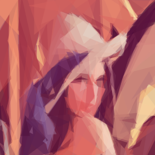 |  | 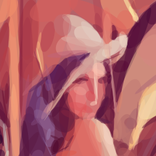 |
|  | 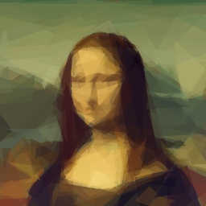 | 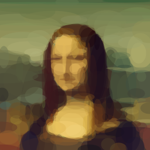 | 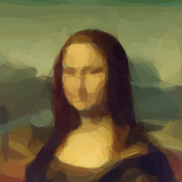 |
|  | 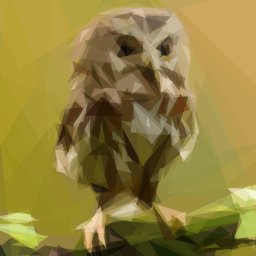 | 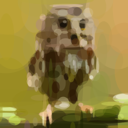 | 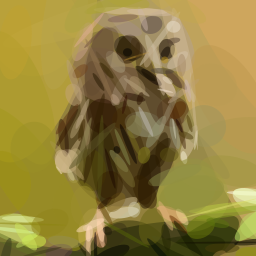 |
|  |  | 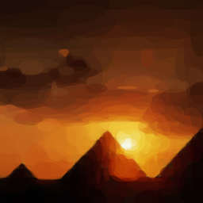 | 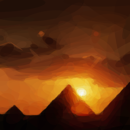 |

### Progression

This GIF demonstrates the iterative nature of the algorithm, attempting to
minimize the error by adding one shape at a time. (Use a `.gif` output file to
generate one yourself!) `-n 100 -s 512 -seed 1 -j 4`: 42 frames, 101 KB.

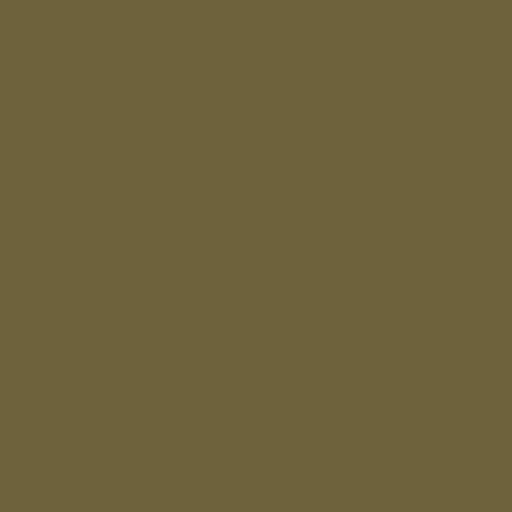

### Regenerating the Examples

These files depend on the build: another Go version, `GOAMD64` value or CPU
architecture can change them with no change of the code, see [Reproducible
Output](#reproducible-output), and so can a change of the search.

```sh
make examples
```

The target builds `primitive.bin` and overwrites `examples/output/`, in about 20
s on the machine of [CPU Load](#cpu-load). `git restore examples/output` undoes
it.

## Upstream Gallery

The pictures in this section are the examples of the [upstream
project](https://github.com/fogleman/primitive). They come from an older version
of its code, not from this fork, and are served from the site of its author.

### Static Animation

Since the algorithm has a random component to it, you can run it against the
same input image multiple times to bring life to a static image.


### Creative Constraints

If you're willing to dabble in the code, you can enforce constraints on the
shapes to produce even more interesting results. Here, the rectangles are
constrained to point toward the sun in this picture of a pyramid sunset.


### Shape and Iteration Comparison Matrix

The matrix below shows triangles, ellipses and rectangles at 50, 100 and 200
iterations each.


### Photographs

Here are more examples from interesting photos found on Flickr.


## Development

The tools are pinned in `tools/` and run through `go tool`. `make lint` also
needs [`uvx`](https://docs.astral.sh/uv/) for zizmor. Tests that render SVG need
`rsvg-convert` and skip without it; CI does not have it.

| Command | What it does |
| --- | --- |
| `make` | builds `primitive.bin` |
| `make check` | the CI job: `lint tidy test cover fuzz vuln build` |
| `make test` | `go test -race` |
| `make cover` | fails below 99% of statements; report in `.cover/cover.html` |
| `make fuzz FUZZTIME=10m` | each fuzz target for `FUZZTIME`, 10 s by default |
| `make mutants BASE=origin/master` | mutation run on changed lines, once before a merge |
| `make examples` | rewrites `examples/output/`, see [Regenerating the Examples](#regenerating-the-examples); after an intended change of the search |
| `go test ./primitive -run TestGoldenOutput -update` | rewrites the golden files after an intended change of the search; only on a default amd64 build |

Mutation runs, their timeouts and the list of equivalent mutants are described
in [docs/mutants.md](docs/mutants.md). A change of behaviour updates
`README.md`, `README.ru.md`, `CHANGELOG.md` and `CHANGELOG.ru.md` together.

## Releases

A release is a tag on the head of `master`, in the form `vX.Y.Z`, or
`vX.Y.Z-rcN` for a release candidate. The steps are for a maintainer with push
rights.

1. Run the whole-tree mutation run on `master`, see
   [docs/mutants.md](docs/mutants.md), and move the `Unreleased` entries of both
   changelogs to the new version.
2. Merge to `master` and wait for a green `CI` workflow run on that commit.
3. Tag the head of `master` and push the tag:

   ```sh
   TAG=v1.2.3
   git fetch origin
   git tag "$TAG" origin/master
   git push origin "$TAG"
   ```

The `Release` workflow then runs `make release-gate`: it wants the tag format
above, the tag on the head of `origin/master` and a successful `ci.yml` push run
for that commit, and `make vuln` follows. A failed gate publishes nothing:
delete the tag, fix the cause and tag again.

After the gate goreleaser publishes the archives, `checksums.txt`, release notes
from the commit messages and the image. A tag with `-rc` becomes a GitHub
prerelease and does not move the image tag `latest`. `go install ...@latest`
also passes over prereleases.

Provenance is attested last. **A failed attestation leaves a published release
and image without provenance, and the job cannot run again until that release is
deleted.** The tag and the image stay until they are deleted by hand.

To check a published archive, see [Release Archives](#release-archives).

## License

MIT, see [LICENSE.md](LICENSE.md). Copyright (C) 2016 Michael Fogleman. The
license of the upstream project applies to this fork unchanged.
