# Primitive Pictures

English: [README.md](README.md).

Воспроизведение картинок геометрическими примитивами: `primitive` берёт картинку
и записывает её заново набором треугольников, эллипсов, прямоугольников или
кривых, в PNG, JPEG, SVG или анимированный GIF.

Этот репозиторий - форк
[fogleman/primitive](https://github.com/fogleman/primitive) Майкла Фоглмана
(Michael Fogleman), лицензия MIT сохраняется, см. [Лицензия](#лицензия). У форка
свой модуль Go, он тратит намного меньше CPU на картинку, пишет GIF без
ImageMagick и добавляет `-seed`, `-nc` и `-version`.
[CHANGELOG.ru.md](CHANGELOG.ru.md) перечисляет все отличия и что они ломают.

На этой странице: установка, флаги, форматы, пределы CPU и памяти, алгоритм,
примеры, разработка и выпуски. API Go описан в исходном коде, мутационное
тестирование - в [docs/mutants.md](docs/mutants.md).

## Как это работает

На вход подаётся целевая картинка. Алгоритм ищет одну фигуру, которая сильнее
всего уменьшает ошибку между целевой картинкой и нарисованной. Затем процесс
повторяется: фигуры добавляются *по одной*. Чтобы получить результат, узнаваемый
и при этом художественный и абстрактный, нужно примерно от 50 до 200 фигур.

## Установка

Бинарные файлы и образы появляются с первого тега `vX.Y.Z`. До этого тега
используйте `go install` или сборку из исходников.

### Архивы выпусков

На [странице выпусков](https://github.com/6RUN0/primitive/releases) лежат архивы
для Linux, macOS, FreeBSD (`.tar.gz`) и Windows (`.zip`), для amd64 и arm64, и
файл `checksums.txt`. У каждого файла из `checksums.txt` есть attestation
происхождения сборки. Проверка архива:

```sh
VERSION=1.2.3
gh attestation verify "primitive_${VERSION}_linux_amd64.tar.gz" --repo 6RUN0/primitive
```

Бинарный файл статический, других программ не требует. В архиве также лежат
лицензия, оба README, оба журнала изменений и `docs/`, но не `examples/`,
поэтому картинки раздела [Примеры](#примеры) видны только на странице
репозитория.

### Образ контейнера

`ghcr.io/6run0/primitive` - образ distroless для linux/amd64 и linux/arm64,
точка входа - сам бинарный файл. Теги - версия без `v` и `latest`, кандидаты в
выпуск его не сдвигают. У образа нет attestation.

Образ работает под пользователем 65532 и не может писать в каталог, который ему
не принадлежит: поиск заканчивается, затем программа выходит с кодом 1.
Смонтируйте каталог и передайте своего пользователя:

```sh
docker run --rm -u "$(id -u):$(id -g)" -v "$PWD:/work" ghcr.io/6run0/primitive \
    -i /work/input.png -o /work/output.gif -n 100
```

### Go install

Нужен [Go](https://go.dev/doc/install) 1.27.0 или новее. `go.mod` называет набор
инструментов `go1.27.3`: в 1.27.0 есть известные уязвимости стандартной
библиотеки. При `GOTOOLCHAIN=auto` (умолчание) более старый локальный Go
скачивает этот набор. При `GOTOOLCHAIN=local` Go ниже 1.27.0 отказывается
собирать, а версии от 1.27.0 до 1.27.2 собирают сами собой.

```sh
go install github.com/6RUN0/primitive@latest
primitive -i input.png -o output.png -n 100
```

### Сборка из исходников

```sh
go build -o primitive.bin .
./primitive.bin -i input.png -o output.png -n 100
```

Аргумент `-o primitive.bin` обязателен: обычный `go build` падает с ошибкой
`build output "primitive" already exists and is a directory`, потому что каталог
пакета называется как бинарный файл. `make` запускает ту же команду.

## Использование

```sh
primitive [OPTIONS] -i input -o output -n count
```

`-i`, `-o` и `-n` обязательны. Файлы из `-o` перезаписываются без вопроса.

Умолчание `-r` уменьшает вход до 256 пикселей, и обычно этого достаточно: мелкие
детали под фигурами всё равно теряются, а запуск идёт быстрее.

Несколько выходов одного поиска:

```sh
primitive -i input.png -o output.png -o output.svg -n 100
```

Этапы поиска одной картинки, здесь 50 треугольников, затем 100 эллипсов с
большей непрозрачностью. `-m`, `-a`, `-rep` и `-mqw` действуют на следующий за
ними `-n`:

```sh
primitive -i input.png -o output.png -m 1 -n 50 -m 3 -a 200 -n 100
```

При одном `-n` эти флаги действуют, где бы ни стояли. При нескольких `-n`
значения после последнего `-n` на поиск не влияют, но всё равно проверяются.

### Флаги

| Флаг | Умолчание | Описание |
| --- | --- | --- |
| `-i` | обязателен | входной файл, `-` читает стандартный ввод |
| `-o` | обязателен | выходной файл, можно повторять; расширение выбирает формат, любое другое, кроме перечисленных в [Выходные форматы](#выходные-форматы), отвергается до поиска; `-` пишет SVG в стандартный вывод |
| `-n` | обязателен | число фигур, больше 0; можно повторять, см. выше |
| `-m` | 1 | режим: 0=combo, 1=triangle, 2=rect, 3=ellipse, 4=circle, 5=rotatedrect, 6=beziers, 7=rotatedellipse, 8=polygon; любое другое значение отвергается |
| `-a` | 128 | альфа фигур от 0 до 255, `0` поручает поиску выбирать её для каждой фигуры; любое другое значение отвергается |
| `-bg` | среднее по входу | начальный цвет фона: шестнадцатеричные цифры `rgb`, `rgba`, `rrggbb` или `rrggbbaa`, можно с `#` в начале, который в оболочке надо заключать в кавычки; любое другое значение отвергается |
| `-r` | 256 | уменьшить вход до поиска так, чтобы длинная сторона была не больше этого числа пикселей; вход, который помещается, не меняется, увеличения нет; `0` или отрицательное значение сохраняет полный размер, см. [Большие входы](#большие-входы) |
| `-s` | 1024 | размер результата по длинной стороне в пикселях, больше 0; выходы GIF и JPEG допускают до 65535, большее значение отвергается до поиска; короткая сторона сохраняет пропорции и равна минимум 1 |
| `-j` | 0 | число параллельных исполнителей, значение меньше 1 берёт все ядра; см. [Нагрузка на CPU](#нагрузка-на-cpu) |
| `-nc` | 125 | случайных фигур перед каждым восхождением, больше 0; см. [Нагрузка на CPU](#нагрузка-на-cpu) |
| `-rep` | 0 | добавлять N лишних фигур за итерацию с упрощённым поиском, полезно в основном для `-m 6`; значение меньше 1 не добавляет ни одной |
| `-mqw` | 0,5 | наибольшая толщина кривых `-m 6` в пикселях уменьшенного входа, должна быть конечным числом больше 0; толщина начинается с 0,5; значение ниже 0,5 не даёт более тонких кривых, но меняет поиск: мутация ставит толщину 0,5 или это значение, и при `-n 100 -r 64 -j 1`, seed от 1 до 4, на `0.1`, `0.3` и `0.45` все кривые остались толщиной 0,5, а картинка отличается от картинки при `0.5` |
| `-ma` | 0 | прекратить добавлять фигуры, когда оценка (среднеквадратичная ошибка от 0 до 1, меньше - лучше) не выше этого значения |
| `-mp` | 100 | прекратить добавлять фигуры, когда оценка ниже оценки чистого фона на столько процентов |
| `-nth` | 1 | сохранять каждый N-й кадр, больше 0; действует только с путём, где есть `%d` |
| `-int` | 50 | задержка между кадрами GIF в сотых долях секунды, от 0 до 65535, любое другое значение отвергается |
| `-seed` | 0 | начальное значение генератора, `0` выбирает новое на каждый запуск; см. [Воспроизводимый вывод](#воспроизводимый-вывод) |
| `-v` | выкл. | печатать в стандартный вывод прочитанный вход, seed, по строке на этап, по строке на фигуру и каждый записанный файл |
| `-vv` | выкл. | печатать ещё и по строке на восхождение |
| `-version` | выкл. | напечатать версию и выйти: номер выпуска, версию модуля при `go install` или `go build` клона, `devel` в сборке без данных системы контроля версий |

Когда `-ma` или `-mp` останавливает поиск, все выходы записываются с уже
найденными фигурами. `-v` делит стандартный вывод с `-o -`, поэтому вместе они
подмешивают строки журнала в SVG.

### Коды выхода

| Код | Значение |
| --- | --- |
| 0 | завершено; также `-h` и `-version` |
| 1 | недопустимое значение флага, нечитаемый или пустой вход, ошибка записи |
| 2 | неизвестный флаг или значение не того типа, например `-j x` |

Недопустимые значения выводятся в стандартный поток ошибок как `ERROR: ...` до
чтения входа. Путь, в который нельзя записать, заранее не проверяется: ошибка
возникает при первой записи, а для выхода без `%d` это после всего поиска.

## Входные форматы

PNG, JPEG, GIF (только первый кадр) и WebP, определяются по содержимому файла, а
не по имени. При расчёте среднего цвета фона прозрачные пиксели считаются
чёрными. Изображение без пикселей отвергается.

## Выходные форматы

Формат выбирается расширением выходного файла, в любом регистре.

| Расширение | Результат | Наибольший `-s` |
| --- | --- | --- |
| `.png` | растр | своего предела нет |
| `.jpg`, `.jpeg` | растр, качество 95 | 65535 |
| `.svg` | вектор, см. [Вывод SVG](#вывод-svg) | своего предела нет |
| `.gif` | анимация, см. [Вывод GIF](#вывод-gif) | 65535 |

Выход без `%d` записывается один раз, когда поиск заканчивается: прерванный
запуск файла не оставляет.

### Файлы кадров

Если в пути PNG, JPEG или SVG есть `%d`, `%03d` и подобное, каждый кадр
сохраняется отдельно, номер кадра равен числу нарисованных фигур. `-nth 3`
оставляет каждый третий кадр и всегда последний: `-o 'x%03d.png' -n 7 -nth 3`
пишет `x003.png`, `x006.png` и `x007.png`.

GIF остаётся одним файлом, в имени стоит номер последнего кадра. Путь с `%`
должен быть правильным шаблоном с одним числом, буквальный знак процента пишется
`%%`; всё остальное отвергается до поиска.

## Нагрузка на CPU

На каждую фигуру приходится всего 8 восхождений (hill climb) независимо от числа
исполнителей, и каждое восхождение начинается с лучшей из `-nc` случайных фигур.

| Флаг | Что меняется | Цена |
| --- | --- | --- |
| `-j` | сколько исполнителей делят 8 восхождений: общая работа не меняется, время работы падает до 8 исполнителей; выше 8 лишние исполнители простаивают | каждое значение ниже 8 даёт другую картинку, см. [Воспроизводимый вывод](#воспроизводимый-вывод) |
| `-nc` | случайных фигур на восхождение: CPU почти следует за ним, ошибка меняется мало | меньшее значение повышает ошибку, тем сильнее, чем больше фигур |
| `-r` | пиксели цели: CPU и память растут с её размером, см. таблицу ниже | детали входа теряются; `-s` остаётся свободным, от него фигуры не зависят |

Чтобы не мешать другим задачам на общей машине, сочетайте низкий приоритет,
одного исполнителя и меньшую цель:

```sh
nice -n 19 primitive -i input.png -o output.png -n 100 -j 1 -r 128
```

### Измерения

Все на AMD Ryzen 7 2700 (16 потоков), linux/amd64, go1.27.3, 2026-11-06, при
другой нагрузке на машине. CPU - время user плюс system. rmse считается по
выходному PNG, приведённому `draw.BiLinear` к размеру входа после `-r`, по RGB
от 0 до 1; это значение выше оценки `-v`.

Текущий поиск против прежнего, который перебирал 500 кандидатов и выше 8
исполнителей запускал по восхождению на исполнителя. Входы `lenna`, `monalisa`,
`owl`, `pyramids`, `-n 100 -a 128 -r 256 -s 1024`, seed от 1 до 4, запуски по
одному, средняя загрузка от 3 до 5; каждая строка - среднее по 16 запускам. `-j`
по умолчанию здесь равен 16.

| `-m` | `-j` | CPU до, с | CPU сейчас, с | Изменение | Время до, с | Время сейчас, с | rmse до | rmse сейчас | Изменение |
| --- | --- | --- | --- | --- | --- | --- | --- | --- | --- |
| 0 | умолч. | 24,873 | 2,897 | -88,4% | 3,176 | 1,054 | 0,05333 | 0,05473 | +2,63% |
| 0 | 1 | 8,044 | 1,717 | -78,7% | 8,077 | 1,723 | 0,05467 | 0,05462 | -0,09% |
| 1 | умолч. | 16,259 | 1,383 | -91,5% | 2,590 | 0,503 | 0,05413 | 0,05523 | +2,04% |
| 1 | 1 | 5,147 | 0,740 | -85,6% | 5,146 | 0,733 | 0,05451 | 0,05497 | +0,83% |
| 3 | умолч. | 25,840 | 0,976 | -96,2% | 2,931 | 0,382 | 0,05643 | 0,05808 | +2,93% |
| 3 | 1 | 7,606 | 0,557 | -92,7% | 7,630 | 0,587 | 0,05700 | 0,05793 | +1,64% |
| 7 | умолч. | 49,709 | 6,586 | -86,8% | 5,106 | 1,515 | 0,05490 | 0,05633 | +2,60% |
| 7 | 1 | 16,758 | 4,578 | -72,7% | 16,669 | 4,584 | 0,05558 | 0,05648 | +1,63% |

Цена - столбец rmse: до +2,93% при `-j` по умолчанию, а по картинкам от +1,60 до
+2,80% по всем строкам. Режимов 2, 4, 5, 6 и 8 в этой таблице нет.

`-nc 125` против `-nc 500`, который возвращает прежнее число кандидатов. 5
входов, seed от 1 до 4, `-j 1 -a 128 -r 256 -s 256`, 7 запусков параллельно:

| Фигур | Режимы | Пар запусков | CPU | rmse |
| --- | --- | --- | --- | --- |
| 100 | от 0 до 8 | 180 | -53,0% | +0,59% |
| 200 | 0, 1, 3, 7 | 80 | -59,2% | +0,91% |

Потеря зависит от картинки: на 200 фигурах +2,38% у `pyramids`, +1,49% у
`monalisa`, +1,39% у `owl`, +1,10% у `lenna`.

`-j` на `examples/lenna.png`, `-m 1 -n 100 -s 1024`, seed от 1 до 4, 3 повтора,
средняя загрузка от 4 до 13 от других задач, поэтому сравнивать строки можно
только между собой:

| `-j` | CPU, с | Время, с |
| --- | --- | --- |
| 1 | 1,25 | 1,36 |
| 2 | 1,25 | 1,08 |
| 4 | 1,27 | 0,87 |
| 8 | 1,30 | 0,77 |
| 16 | 1,31 | 0,76 |

`-r` на той же картинке (512x512), `-j 1`, seed от 1 до 4, 1 повтор, средняя
загрузка от 3 до 4. Пик памяти снят в одном запуске с seed 1:

| `-r` | CPU, с | Время, с | Пик памяти, МиБ |
| --- | --- | --- | --- |
| 64 | 0,42 | 0,41 | 15 |
| 128 | 0,54 | 0,53 | не измерялся |
| 256 | 0,82 | 0,81 | 23 |
| 512 | 1,58 | 1,57 | 45 |

Ошибка при разных `-r` не сравнивалась: rmse считается в размере уменьшенного
входа. Измерения повторяются, когда меняется поиск или умолчание `-nc`.

## Воспроизводимый вывод

Одинаковые вход, флаги, `-seed` и `-j` повторяют результат побайтно в пределах
одной сборки программы; обещание действует только для одного бинарного файла.
`-v` печатает seed запуска. Другой `-j` даёт другую картинку, кроме значений от
8 и выше: они дают одну, а `-j` по умолчанию зависит от числа ядер, поэтому
задавайте оба флага явно. Новая версия может изменить картинку при том же seed:
[журнал изменений](CHANGELOG.ru.md) сообщает об этом.

Две сборки могут расходиться при одном seed: Go сливает умножение и сложение
чисел с плавающей точкой там, где у целевого процессора есть такая инструкция.
Это затрагивает геометрию фигур в некоторых режимах и оценку, по которой
ранжируются кандидаты, во всех режимах, кроме `-m 6`, поэтому совпадение между
сборками не обещано ни для одного режима. Замер на go1.27.3 для linux/amd64,
`GOAMD64=v3` против `v1` по умолчанию: `lenna`, `owl`, `monalisa` и `pyramids`
при `-r 64 -n 30 -j 1 -s 128`, seed от 1 до 12, дали другой PNG в 12 запусках из
48 для `-m 0`, 1 для `-m 1`, 35 для `-m 5`, 14 для `-m 6` и ни в одном для
остальных режимов; число зависит от картинки. Выпущенные бинарные файлы и образы
amd64 используют `v1`. Отличается ли arm64 от amd64, не измерялось;
`TestGoldenOutput` пропускает себя на arm64 и при `GOAMD64=v3`.

## Большие входы

`-r 0` или большой `-r` меняет память на детали. До 2^26 пикселей (8192x8192)
поиск работает с таблицами по 56 байт на пиксель, и с размером растёт только та
часть времени, что идёт за контуром фигуры. Выше 2^26 пикселей или шире 66051
пикселя таблиц нет, каждый кандидат стоит времени пропорционально своей площади,
и программа минутами ничего не печатает.

**За пределом программа не выдаёт ни предупреждения, ни ошибки: запуск
продолжается, только намного медленнее.**

| Вход | Таблицы | CPU | Пик памяти |
| --- | --- | --- | --- |
| 5000x5000, `-n 3 -j 1` | да | 9,4 с | 1,7 ГиБ |
| 8192x8192, `-n 3 -j 1` | да | 39 с | 5,3 ГиБ |
| 8193x8192, `-n 1 -j 1` | нет | первая фигура не готова через 165 с | не достигнут |

Замер на go1.27.3, Ryzen 7 2700, гладкая картинка, растянутая до нужного
размера, `-s 64`, `-seed 1`, при другой нагрузке на машине. На 8192x8192 время
работы было 144 с при 39 с CPU, причина не разделена. 10000x10000 до конца не
запускался: оценка по коду, а не замер, даёт от 12 до 25 минут на первую фигуру.
Чтобы отменить выбор, остановите запуск и начните заново с меньшим `-r`.

## Вывод SVG

SVG - одна строка текста. `viewBox` имеет размер уменьшенного входа, а не `-s`,
поэтому `-s` файл не меняет. Дробные координаты `-m 6`, `-m 7`, `-m 8` и `-m 0`
хранят 2 знака в этих единицах, так что точка может сдвинуться на 0,005 x
масштаб пикселей результата, где масштаб - `-s`, делённый на длинную сторону
входа. Непрозрачность хранит 3 знака. Фигуры обрезаются по кадру, фон с альфой
её сохраняет.

Замер на `examples/lenna.png`, `-n 200 -s 1024 -seed 7 -j 8`, go1.27.3,
rsvg-convert 2.62.3: отрисованный SVG отличается от PNG того же запуска на
среднеквадратичную ошибку от 0,0023 до 0,0033 полного диапазона при `-r 128` и
`-r 256`. При `-r 16 -s 4096`, масштаб 256, ошибка не больше 0,0058 против
0,0045 с 6 знаками.

В этих запусках 200 фигур занимают от 9 до 23 КБ, от 2,4 до 6,3 КБ после
`gzip -9`.

## Вывод GIF

GIF показывает, как добавляются фигуры, повторяется бесконечно и не требует
внешних программ. Он начинается с чистого фона, затем добавляет кадр всякий раз,
когда оценка упала минимум на 0,001 с прошлого кадра, поэтому кадров меньше, чем
фигур, и всегда заканчивается готовой картинкой. Последний кадр держится 2,5 с
независимо от `-int`.

- Цвета: до 255 цветов, взятых из последнего кадра, без дизеринга; цвета,
  которые есть только на ранних кадрах, приближаются.
- Прозрачность: пиксель с непрозрачностью ниже половины становится прозрачным,
  любой другой показывает свой цвет полностью непрозрачным, поэтому картинка с
  полупрозрачным `-bg` отличается от своего PNG.
- Время: весь GIF отрисовывается после поиска, в размере `-s`.

Замер на `examples/lenna.png`, `-n 100 -m 1 -j 8 -seed 5 -s 1024`: 49 кадров,
226 КБ.

## Примитивы

Поддерживаются следующие примитивы:

| `-m` | Примитив | Элемент SVG |
| --- | --- | --- |
| 0 | Смесь: разные типы из списка ниже на одной картинке | на фигуру один из элементов ниже |
| 1 | Треугольник | `<path>` |
| 2 | Прямоугольник (по осям) | `<rect>` |
| 3 | Эллипс (по осям) | `<ellipse>` |
| 4 | Окружность | `<ellipse>` |
| 5 | Повёрнутый прямоугольник | `<rect>` с `transform` |
| 6 | Квадратичная кривая Безье, штрих без заливки; толщина задаётся `-mqw` | `<path>` со `stroke` |
| 7 | Повёрнутый эллипс | `<ellipse>` с `transform` |
| 8 | Многоугольник из 4 вершин, может пересекать сам себя | `<path>` |

Новые фигуры добавляются реализацией этого интерфейса. `SVG` получает цветовые
атрибуты фигуры и возвращает один элемент. `Model.SVG` даёт `fill` всем фигурам,
кроме `*Quadratic`, поэтому новая штриховая фигура требует правки и там.

```go
type Shape interface {
	Rasterize() []Scanline
	Copy() Shape
	Mutate()
	Draw(dc *gg.Context, scale float64)
	SVG(attrs string) string
}
```

## Как это работает, часть II

Пусть есть `Target Image` - то, что надо воссоздать. Начинаем с пустого холста,
залитого одним сплошным цветом: сейчас это средний цвет `Target Image`. Этот
холст называем `Current Image`. Теперь оцениваем фигуры. Чтобы оценить фигуру,
рисуем её поверх `Current Image` и получаем `New Image`. `New Image`
сравнивается с `Target Image`, и получается оценка. В качестве оценки берётся
[среднеквадратичная
ошибка](https://en.wikipedia.org/wiki/Root-mean-square_deviation).

```text
Current Image + Shape => New Image
RMSE(New Image, Target Image) => Score
```

Фигуры порождаются случайно. Можно создать случайную фигуру и оценить её. Затем
изменить фигуру (сдвинуть вершину треугольника, изменить радиус или центр
эллипса и так далее) и оценить снова. Если изменение улучшило оценку, оно
остаётся, иначе фигура возвращается к прежнему состоянию. Повторение этого
процесса называется [восхождением к
вершине](https://en.wikipedia.org/wiki/Hill_climbing) (hill climbing).
Восхождение склонно застревать в локальных минимумах, поэтому оно на самом деле
выполняется много раз с разных начальных фигур. Можно также создать N случайных
фигур и выбрать лучшую перед началом восхождения. [Имитация
отжига](https://en.wikipedia.org/wiki/Simulated_annealing) - тоже хороший
вариант, но в моих тестах восхождение оказалось таким же хорошим и более
быстрым, по крайней мере для этой задачи. Кода отжига в этом форке нет.

Найдя фигуру с хорошей оценкой, добавляем её в `Current Image`, где она
останется без изменений. Затем процесс начинается заново для следующей фигуры и
повторяется столько раз, сколько нужно.

В этом форке N - это `-nc`, а число восхождений закреплено на 8. Кроме `-m 6` и
изображений с прозрачностью или без таблиц (см. [Большие
входы](#большие-входы)), кандидаты и восхождения ранжируются по быстрой оценке,
а результат каждого восхождения затем оценивается точно.

## Особенности

- [Восхождение к вершине](https://en.wikipedia.org/wiki/Hill_climbing) от
  нескольких случайных фигур для оптимизации
- Построчная растеризация фигур на чистом Go (удобна для следующих пунктов)
- Оптимальный цвет вычисляется по затронутым пикселям каждой фигуры (цвет
  считается напрямую, а не подбирается)
- Частичная разность изображений для быстрой оценки (учитываются только
  изменившиеся пиксели)
- Сглаженный вывод

## Источник идеи

Два следующих абзаца написаны автором исходного проекта.

Этот проект изначально вдохновлён популярной и отличной работой Роджера
Йоханссона - [Genetic Programming: Evolution of Mona
Lisa](https://rogeralsing.com/2008/12/07/genetic-programming-evolution-of-mona-lisa/).
С тех пор как я увидел эту статью, совсем ещё новую, я время от времени
возвращался к этой задаче. Но только теперь результаты меня устроили.

Надо отметить, что моя реализация существенно отличается от исходной работы
Роджера. Моя - не генетический алгоритм. Моя работает только с одной фигурой за
раз. Моя намного быстрее (насколько я знаю) и поддерживает много типов фигур.

## Примеры

Эти картинки получены программой из этого репозитория из входов
`examples/<image>.png`, с `-n 200 -seed 1 -j 4` и остальными флагами по
умолчанию. Каждый SVG занимает примерно от 10 до 20 КБ.

| Вход | Треугольники (`-m 1`) | Эллипсы (`-m 3`) | Повёрнутые эллипсы (`-m 7`) |
| --- | --- | --- | --- |
|  | 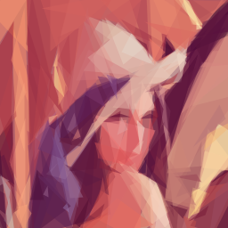 |  | 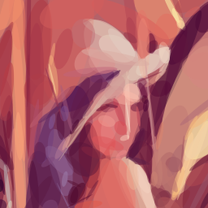 |
|  | 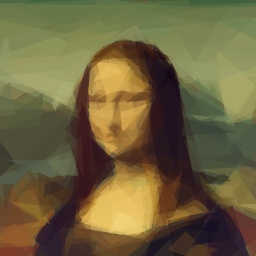 | 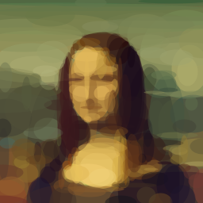 | 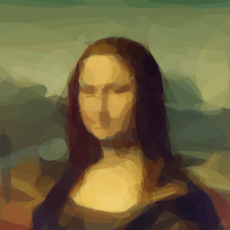 |
|  | 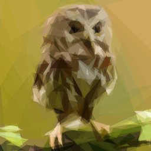 | 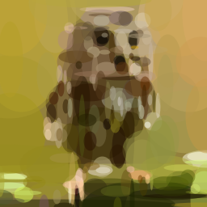 | 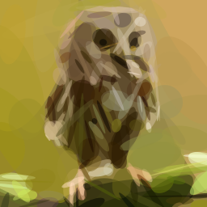 |
|  |  | 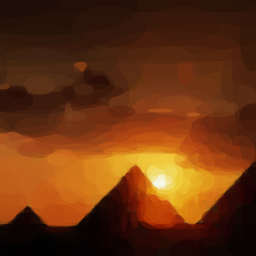 | 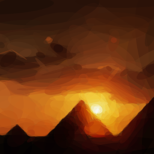 |

### Развитие

Этот GIF показывает, что алгоритм работает шагами: ошибка уменьшается
добавлением по одной фигуре. (Чтобы получить такой же, укажите выходной файл
`.gif`.) `-n 100 -s 512 -seed 1 -j 4`: 42 кадра, 101 КБ.

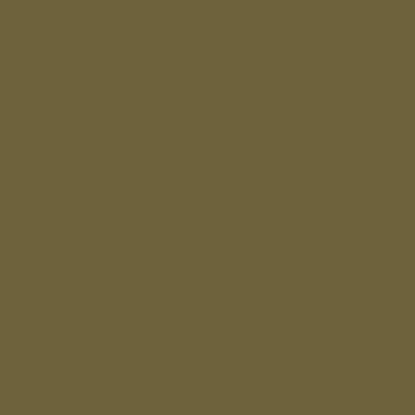

### Повторное создание примеров

Эти файлы зависят от сборки: другая версия Go, значение `GOAMD64` или
архитектура процессора могут изменить их без изменения кода, см.
[Воспроизводимый вывод](#воспроизводимый-вывод), как и изменение поиска.

```sh
make examples
```

Команда `make examples` собирает `primitive.bin` и перезаписывает
`examples/output/`, примерно за 20 с на машине из раздела [Нагрузка на
CPU](#нагрузка-на-cpu). Отмена - `git restore examples/output`.

## Галерея upstream

Картинки этого раздела - примеры [проекта
upstream](https://github.com/fogleman/primitive). Они получены старой версией
его кода, а не этим форком, и лежат на сайте его автора.

### Статичная анимация

В алгоритме есть случайная составляющая, поэтому несколько запусков на одной
картинке оживляют статичное изображение.


### Творческие ограничения

Если вы готовы поправить код, можно наложить на фигуры ограничения и получить
ещё более интересный результат. Здесь прямоугольники на картинке с закатом над
пирамидой обязаны указывать на солнце.


### Матрица сравнения фигур и итераций

Матрица ниже показывает треугольники, эллипсы и прямоугольники на 50, 100 и 200
итерациях.


### Фотографии

Ещё примеры на интересных фотографиях с Flickr.


## Разработка

Инструменты закреплены в `tools/` и запускаются через `go tool`. Для zizmor
`make lint` требует ещё [`uvx`](https://docs.astral.sh/uv/). Тесты,
отрисовывающие SVG, требуют `rsvg-convert` и без него пропускаются; в CI его
нет.

| Команда | Что делает |
| --- | --- |
| `make` | собирает `primitive.bin` |
| `make check` | задача CI: `lint tidy test cover fuzz vuln build` |
| `make test` | `go test -race` |
| `make cover` | падает ниже 99% операторов; отчёт в `.cover/cover.html` |
| `make fuzz FUZZTIME=10m` | каждая цель fuzz на `FUZZTIME`, по умолчанию 10 с |
| `make mutants BASE=origin/master` | мутационный прогон по изменённым строкам, один раз перед слиянием |
| `make examples` | перезаписывает `examples/output/`, см. [Повторное создание примеров](#повторное-создание-примеров); после намеренного изменения поиска |
| `go test ./primitive -run TestGoldenOutput -update` | перезаписывает эталонные файлы после намеренного изменения поиска; только на сборке amd64 по умолчанию |

Мутационные прогоны, их тайм-ауты и список эквивалентных мутантов описаны в
[docs/mutants.md](docs/mutants.md). Изменение поведения обновляет вместе
`README.md`, `README.ru.md`, `CHANGELOG.md` и `CHANGELOG.ru.md`.

## Выпуски

Выпуск - тег на вершине `master` вида `vX.Y.Z` или `vX.Y.Z-rcN` для кандидата в
выпуск. Шаги выполняет сопровождающий с правом записи.

1. Запустите мутационный прогон всего дерева на `master`, см.
   [docs/mutants.md](docs/mutants.md), и перенесите записи `Unreleased` обоих
   журналов изменений в новую версию.
2. Выполните слияние в `master` и дождитесь зелёного прогона workflow `CI` на
   этом коммите.
3. Поставьте тег на вершину `master` и отправьте его:

   ```sh
   TAG=v1.2.3
   git fetch origin
   git tag "$TAG" origin/master
   git push origin "$TAG"
   ```

Затем workflow `Release` запускает `make release-gate`: тот требует формат тега,
описанный выше, тег на вершине `origin/master` и успешный прогон `ci.yml` по
push для этого коммита, затем идёт `make vuln`. Если проверка не прошла, ничего
не публикуется: удалите тег, устраните причину и поставьте тег заново.

После проверки goreleaser публикует архивы, `checksums.txt`, заметки о выпуске
из сообщений коммитов и образ. Тег с `-rc` становится предварительным выпуском
GitHub и не сдвигает тег образа `latest`. `go install ...@latest` тоже
пропускает такие выпуски.

Attestation происхождения выполняется последним. **Сбой attestation оставляет
опубликованные выпуск и образ без подтверждения происхождения, и задачу нельзя
запустить снова, пока этот выпуск не удалён.** Тег и образ остаются, пока их не
удалят вручную.

Проверка опубликованного архива описана в разделе [Архивы
выпусков](#архивы-выпусков).

## Лицензия

MIT, см. [LICENSE.md](LICENSE.md). Copyright (C) 2016 Michael Fogleman. Лицензия
исходного проекта действует на этот форк без изменений.
